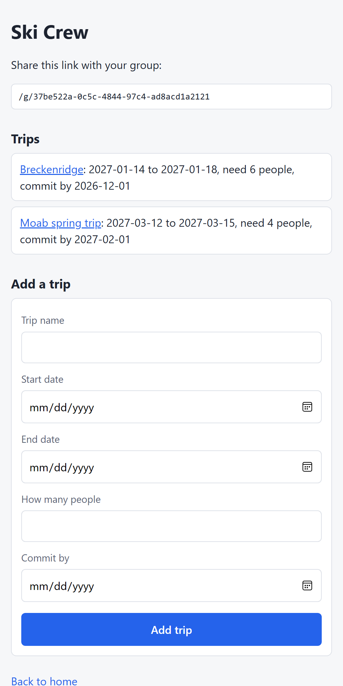
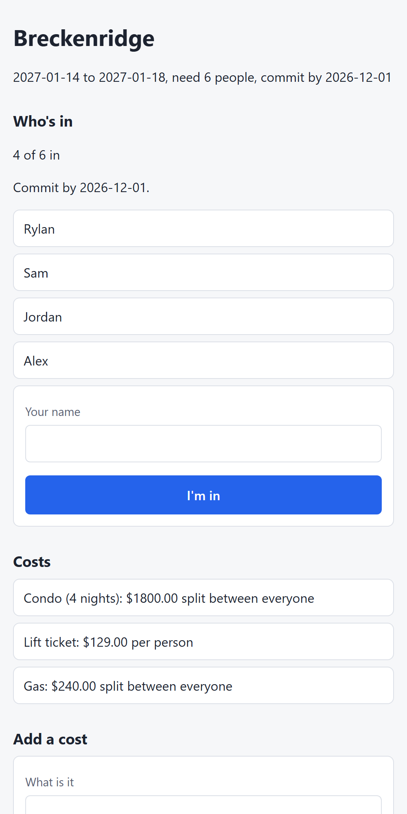

# Trip Planner

Plan group trips without the group-chat chaos: make a private group, share one invite link, add trips, and see who's in and what it costs before the commit deadline.

> **Status:** in progress. Live link coming soon (deploying to Render + Neon Postgres).

<p>
  
  
</p>

## Features
- **Private groups via invite link.** Each group gets an unguessable UUID token; anyone with the link can see the group, nobody else can find it.
- **Trips** with dates, a target group size, and a commit deadline.
- **"I'm in"**: people join a trip by name (duplicate names blocked). The page shows "4 of 6 in" and flips to **"The trip is on!"** when the target is hit.
- **Commit deadline**: joining closes after the deadline day.
- **Costs** per trip: either **split** (lodging, gas: divided between everyone) or **each** (lift tickets: everyone pays their own).
- Mobile-first layout, because trips get planned from phones.

## Tech
Java 21 · Spring Boot · Spring MVC + Thymeleaf · Spring Data JPA / Hibernate · H2 (dev) / PostgreSQL (prod) · JUnit · Docker

## Design decisions
- **UUID invite tokens** with a unique database constraint, so links can't be guessed or collide.
- **`BigDecimal` for money.** `double` stores numbers in binary, so 0.1 + 0.2 = 0.30000000000000004; money has to be exact.
- **Access check on every trip URL.** A trip id from the URL is only used if that trip belongs to the group in the invite token, so changing the id in the URL can't open another group's trip.
- **Testable time.** `Trip.isCommitOpen(LocalDate today)` takes the date as a parameter instead of calling `LocalDate.now()` inside, so a plain unit test can check the deadline day exactly.
- **Secrets stay out of Git.** Production database settings come from environment variables (`application-prod.properties`).

## Run it locally
```bash
./mvnw spring-boot:run
```
Then open http://localhost:8080. Tests: `./mvnw test`

## Roadmap
- [ ] Per-person cost: split total ÷ people in + each costs, and a price-by-group-size table
- [ ] Organizer-only edit link
- [ ] Deploy (Render + Neon) and add the live link here
- [ ] Settle up: fewest payments to square everyone up
